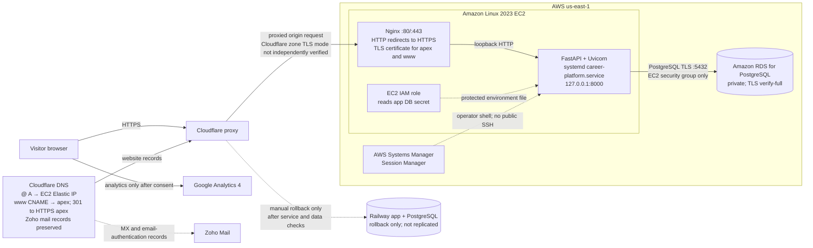

# Adam Riddick Career Platform

A database-driven personal resume and career website. Profile, education, experience, projects, skills, certifications, volunteer work, and links are stored in a database and read on every page request.

- **Live site:** <https://adamriddick.me> (`www.adamriddick.me` redirects here)
- **Hosting now:** AWS EC2 + private Amazon RDS for PostgreSQL (production cutover November 11, 2026)
- **Previous hosting:** Railway web service + Railway PostgreSQL (October 23–November 11, 2026; retained as a rollback option while available)
- **Earlier hosting:** Azure Ubuntu VM with Nginx, Uvicorn, systemd, and SQLite
- **Email:** `adamriddick@adamriddick.me` on Zoho Mail
- **Analytics:** Google Analytics 4, loaded only after the visitor accepts analytics
- **Evidence index:** [docs/project-1-submission.md](docs/project-1-submission.md)

> Hosting and architecture were updated on November 12, 2026, after the AWS production cutover. Azure and Railway details below are retained as history; Railway is kept as a rollback option, not the current public host.

## Contents

1. [What the site does](#what-the-site-does)
2. [Run it locally](#run-it-locally)
3. [How it runs on AWS and how to update it](#how-it-runs-on-aws-and-how-to-update-it)
4. [Rollback](#rollback)
5. [Architecture diagrams](#architecture-diagrams)
6. [DNS records and email authentication](#dns-records-and-email-authentication)
7. [Migration: Railway to AWS](#migration-railway-to-aws)
8. [Who manages what: AWS vs Railway](#who-manages-what-aws-vs-railway)
9. [Decisions](#decisions)
10. [Investigated failures](#investigated-failures)
11. [Remaining limitations](#remaining-limitations)
12. [Costs, expiration dates, and cleanup](#costs-expiration-dates-and-cleanup)
13. [Reflection](#reflection)

## What the site does

- The homepage reads every profile section from the database on each request.
- If the database cannot be reached, the page keeps the last profile it read, shows **"Projects temporarily unavailable,"** and returns **HTTP 503**. The next refresh after the database recovers shows the projects again with HTTP 200, without an application restart. No sample content is substituted. ([`main.py`](main.py), tests in [`tests/test_admin_security_and_home.py`](tests/test_admin_security_and_home.py))
- An empty database returns HTTP 200 with no invented projects.
- `/privacy` explains analytics collection. A consent banner and a **Privacy settings** footer button let visitors accept, reject, or withdraw analytics; the site works fully when analytics is rejected.
- `/admin` is a small content editor behind HTTP Basic authentication. Writes require an exact allowed origin. If admin credentials are not configured, the public site still works and `/admin` returns 503.

Application stack: Python, FastAPI, Jinja templates, SQLAlchemy Core, Alembic migrations. Original design: [specification](docs/superpowers/specs/2026-09-15-personal-resume-career-platform-design.md) and [implementation plan](docs/superpowers/plans/2026-09-22-personal-resume-career-platform-plan.md).

## Run it locally

Python 3.11 or newer is required (the code uses `X | None` type syntax).

```bash
python -m venv .venv
# Windows PowerShell: .venv\Scripts\Activate.ps1
# Linux/macOS: source .venv/bin/activate
pip install -r requirements.txt
# Windows PowerShell: Copy-Item .env.example .env
# Linux/macOS: cp .env.example .env
alembic upgrade head
python -m scripts.seed_dev
uvicorn main:app --reload --env-file .env
python -m unittest discover -s tests
```

Local development uses SQLite at `data/career-platform.db` with `APP_ENV=development`. Alembic creates the schema; `scripts.seed_dev` adds example content only in development against an empty SQLite database. Application startup never creates or seeds a database, and the seed command refuses to run in production.

For local admin access, set non-empty `ADMIN_USERNAME` and `ADMIN_PASSWORD` in `.env`, then open <http://127.0.0.1:8000/admin>.

## How it runs on AWS and how to update it

| Setting | Value |
|---|---|
| AWS region | `us-east-1` |
| Application host | Existing Amazon Linux 2023 EC2 instance; app runs as `career-platform.service` |
| Web entry point | Nginx on EC2; TLS 1.2/1.3; proxies to Uvicorn on `127.0.0.1:8000` |
| Public DNS | Cloudflare-proxied apex A record to the EC2 Elastic IP; `www` points to the apex and redirects to HTTPS apex |
| Database | Private Amazon RDS for PostgreSQL; reachable from the EC2 application security group only |
| Database access | EC2 role reads the app database secret; application uses PostgreSQL TLS verification (`verify-full`). Secrets are not in Git. |
| Application checkout | `/opt/career-platform`, GitHub `ariddick195/career-platform`, branch `main` |
| Configuration | Protected `/etc/career-platform/production.env`; never copy it into the repository or logs |
| Admin | Writes remain fail-closed; unauthenticated `/admin` currently returns HTTP 503 |

In production the app requires PostgreSQL and fails closed without its database configuration; it never falls back to SQLite. Production data is not seeded automatically, and application startup does not run Alembic migrations.

**To deploy a code change to AWS:**

1. Make the change locally, review `git diff`, and run `python -m unittest discover -s tests`.
2. Commit and push the reviewed code to `main`. AWS does not auto-deploy from GitHub; while the Railway rollback service remains connected, a push to `main` may also trigger a Railway deployment.
3. Connect to the existing EC2 instance with AWS Systems Manager Session Manager. In `/opt/career-platform`, fast-forward to `origin/main` (`git pull --ff-only origin main`). If dependency files changed, review and synchronize the persistent `/opt/career-platform/venv` using the repository's dependency instructions before restarting `career-platform.service` with systemd.
4. Verify the service is active, check `/`, `/privacy`, static assets, and the expected fail-closed `/admin` response on the origin, then check the public HTTPS site and certificate.

Do not run `scripts.seed_dev` on production. Schema changes require an explicit, reviewed migration and a current backup; never add Alembic migrations to application startup.

## Rollback

Rolling back code and rolling back data are different problems.

**Code (a bad AWS deploy):**
- Identify the last known-good commit, then deploy that reviewed revision to EC2 through Session Manager and restart `career-platform.service`.
- A `git revert <bad-commit>` pushed to `main` affects the GitHub branch; AWS still requires an explicit EC2 fast-forward and service restart. Railway may also deploy the revert while its service remains connected to `main`.

**Database schema:** do not downgrade automatically. Take and verify a current backup of the affected database first, review the migration's data-loss risk, and run any Alembic command as a deliberate operator action.

**Platform (rolling public traffic back to Railway):** Do not change DNS by itself. First confirm the Railway service is still active, take/verify a current backup, and compare/reconcile any data written since the final Railway-to-RDS restore. RDS and Railway PostgreSQL are separate and do not replicate automatically. Then change only the website apex record back to the currently confirmed Railway target; preserve mail and verification records. Keep AWS and RDS intact until the Railway rollback is verified.

**Historical rollback to Azure:** The older procedure is retained in the [Railway migration runbook](docs/railway-migration-runbook.md#rollback), but it predates the AWS cutover and its DNS target/data instructions must not be used without re-verification.


## Architecture diagrams

### AWS (production since November 11, 2026)



The production Let's Encrypt certificate was obtained with manual DNS validation. It expires **February 10, 2027** and does **not** renew automatically yet; the DNS authentication hook/renewal procedure is still an operational task. Railway is a separate rollback service and database, not a replica of RDS.

### Azure (September 24 to October 23, 2026)

```text
Visitor browser
   |  DNS: Cloudflare (DNS only)  adamriddick.me  A  9.205.27.2
   v
Azure public IP 9.205.27.2  ->  NSG: 22 from my laptop /32 only, 80 and 443 from Any
   v
Ubuntu VM vm-career-platform (private IP 172.16.0.4, Denmark East)
   ├─ sshd :22
   ├─ Nginx :80   -> 301 redirect to HTTPS
   ├─ Nginx :443  TLS ends here (Let's Encrypt certificate, Certbot renewal timer)
   │      | plain HTTP over loopback
   │      v
   │  Uvicorn 127.0.0.1:8000, 2 workers, run by systemd as azureuser
   │      | local file access
   │      v
   │  SQLite /var/lib/career-platform/career-platform.db
```

### Previous public host: Railway (October 23–November 11, 2026; historical request, email, and analytics path)

```text
                     Cloudflare DNS for adamriddick.me (historical Railway routing)
   @    CNAME -> Railway generated hostname (Proxied)
   www  CNAME -> adamriddick.me, Proxied   + redirect rule: 301 to https://adamriddick.me/
   MX   mx.zoho.com / mx2 / mx3            TXT: SPF, DKIM (zoho._domainkey), DMARC, Zoho + Railway verification

WEB REQUEST
Visitor browser --HTTPS 443--> Cloudflare edge --HTTPS--> Railway edge (TLS, routing)
                                                              | HTTP, PORT 8080
                                                              v
                                       web service mindful-creativity (Uvicorn + FastAPI)
                                                              | PostgreSQL protocol, Railway private network
                                                              v
                                                     Postgres-UR2d (Railway volume)

ANALYTICS (only after the visitor accepts)
Visitor browser --HTTPS--> googletagmanager.com (loads gtag.js, ID G-D1DVSBC3WV)
Visitor browser --HTTPS--> google-analytics.com/g/collect  (page_view, click with link_url, outbound)
                                     v
                           GA4 property adamriddick.me (Realtime / DebugView)

EMAIL
Inbound:  sender's mail server --DNS MX lookup--> mx.zoho.com --SMTP 25--> Zoho mailbox --HTTPS--> Zoho webmail
Outbound: Zoho webmail --> Zoho SMTP --SMTP--> recipient server (e.g. Gmail)
          recipient checks SPF (TXT @), DKIM (TXT zoho._domainkey), DMARC (TXT _dmarc) in Cloudflare DNS
```

## DNS records and email authentication

Cloudflare is the authoritative DNS host; Namecheap is only the registrar. Website routing below was verified after the November 11, 2026 AWS cutover. Mail-authentication records remain DNS-only and separate from website routing. Values for verification tokens and public keys are abbreviated.

| Name | Type | Value (shortened) | Proxy | Purpose |
|---|---|---|---|---|
| `@` (`adamriddick.me`) | A | `100.48.139.104` (EC2 Elastic IP) | Proxied | Current AWS website origin; public DNS returns Cloudflare edge addresses |
| `www` | CNAME | `adamriddick.me` | Proxied | Cloudflare redirects `www` to `https://adamriddick.me/` |
| `_railway-verify` | TXT | `railway-verify=…` | DNS only | Retained during the Railway rollback window; not used for website routing |
| `adamriddick.me` | MX | `mx.zoho.com` (10), `mx2.zoho.com` (20), `mx3.zoho.com` (50) | DNS only | Tells other mail servers to deliver my mail to Zoho; lowest number first |
| `adamriddick.me` | TXT | `v=spf1 include:zohomail.com …` | DNS only | **SPF:** Zoho's servers are allowed to send mail as my domain |
| `zoho._domainkey` | TXT | `v=DKIM1; k=rsa; p=…` | DNS only | **DKIM:** public key that checks Zoho's signature on my outgoing mail |
| `_dmarc` | TXT | `v=DMARC1; p=none; rua=mailto:…` | DNS only | **DMARC:** tells receivers to check that SPF or DKIM passed for the domain in From; `p=none` = monitor only, with daily reports |
| `adamriddick.me` | TXT | `zoho-verification=…` | DNS only | Proves to Zoho that I own the domain |

**How the email checks work together.** When Gmail receives my mail, it looks up my SPF record to see whether the sending server is allowed, verifies the DKIM signature with the public key in DNS, and then applies DMARC: at least one of SPF or DKIM must pass *for the same domain shown in From*. Test 04 passed all three for `adamriddick.me` ([ex06.md](docs/evidence/ex06.md#spf-dkim-and-dmarc), [header analysis](docs/evidence/zoho-header-check.md)). Zoho's green checks only show the records exist; the receiving mailbox's result shows a real message passed. If MX were wrong, inbound mail would bounce or go missing; if SPF or DKIM were wrong, my mail would fail DMARC and land in spam.

**Verification:** after cutover, Cloudflare authoritative nameservers and public resolvers returned Cloudflare proxy addresses for apex and `www`; public HTTPS returned 200 with valid TLS, and `www` redirected to the apex. Historical Railway cutover checks are in [railway-migration.md](docs/evidence/railway-migration.md#3-before-cutover).

## Migration: Railway to AWS

The AWS migration reused the existing FastAPI application and moved the live website from Railway to an EC2 application host with a private RDS PostgreSQL database. The earlier Azure-to-Railway migration design and runbook remain available for historical context: [design](docs/superpowers/specs/2026-10-13-railway-postgresql-migration-design.md), [runbook](docs/railway-migration-runbook.md).

**What Git moves:** application code, templates, static files, the Alembic schema, requirements, and tests. **What Git does not move:** production secrets, database rows, or Cloudflare DNS records. Those are handled separately and never stored in Git.

**Application and data:** production requires PostgreSQL and never seeds; schema changes use explicit Alembic migrations rather than startup actions. The AWS service binds Uvicorn to loopback behind Nginx. At the final cutover rehearsal on November 11, the fresh Railway custom-format backup was test-restored locally, and row counts and canonical row digests for all eight application tables matched RDS. This establishes the snapshot match at that time, not ongoing replication.

**Earlier Railway migration:** PostgreSQL compatibility work replaced SQLite-specific access with SQLAlchemy Core and named parameters, added Alembic migrations, and ensured production does not seed the database. The prior SQLite transfer path is documented in code and history, but the Railway-to-RDS move used a PostgreSQL dump/restore rather than that SQLite transfer utility.

**Historical data verification:** the Azure database had a placeholder LinkedIn URL; development seed data had the real URL. After the Azure-to-Railway cutover, the LinkedIn URL was changed in Railway PostgreSQL and verified on the live site. All eight table counts matched the Azure source, and Railway held Azure-only details the seed never creates: [railway-migration.md](docs/evidence/railway-migration.md#2-current-data-comparison).

**Cutovers:** the Azure-to-Railway cutover on October 23, 2026, and its DNS/TLS investigation are recorded in [railway-migration.md](docs/evidence/railway-migration.md). The production AWS cutover followed on November 11, 2026; Railway remains a rollback option only while its service is available, and data changes require reconciliation before rolling back.

**AWS operations:** GitHub `main` does not automatically deploy to EC2. From Session Manager, fast-forward the EC2 checkout at `/opt/career-platform` to `origin/main`, restart `career-platform.service`, then verify the service, origin endpoints, and public HTTPS. Nginx and Certbot run on EC2; production certificate renewal for the manual DNS-01 certificate still needs an authentication hook.

## Who manages what: AWS vs Railway

| Layer | AWS | Railway rollback |
|---|---|---|
| Hardware and hypervisor | AWS | Railway |
| Operating system and patches | **Me** (Amazon Linux 2023 on EC2) | Railway |
| Language runtime (Python) | **Me** (venv on EC2) | Railway builds it; **I** choose the version and dependencies |
| Web entry point | **Me** (Cloudflare proxy, EC2 security group, Nginx) | Railway edge |
| TLS certificate and renewal | **Me** (Nginx/Certbot; production manual-DNS renewal is not automated yet) | Railway manages its edge certificate; **I** keep DNS correct |
| Process management | **Me** (systemd/Uvicorn) | Railway restarts the container; **I** set the start command |
| Application code | **Me** | **Me** |
| Configuration and secrets | EC2 IAM role reads Secrets Manager; protected environment file on EC2 | **Me** (Railway variables) |
| Database software | AWS manages RDS PostgreSQL service | Railway PostgreSQL service |
| Data, schema, backups, restores | **Me**; AWS and Railway databases do not replicate | **Me** |
| DNS | **Me** (Cloudflare; website records proxied, email records preserved) | **Me** (Cloudflare) |
| Testing, monitoring, recovery | **Me** | **Me** |

RDS is managed database infrastructure, not managed application data. I remain responsible for code, configuration, schema changes, backup/restore verification, DNS, TLS renewal monitoring, and recovery. The Railway service is a separate fallback, not a synchronized blue/green deployment.

## Decisions

> This decision records the October 2026 Railway choice as it was made then. The later AWS migration superseded Railway as the public host; Railway is now retained only as a rollback option while available.

### Decision 1: Move from the Azure VM to Railway

**Scenario:** I am the CTO of a three-developer startup running on one Azure VM, and Railway offers to take over the infrastructure.

- **Alternatives:** stay on the Azure VM, move to Railway, or move to another platform such as AWS.
- **My recommendation:** move to Railway for now.
- **Why:** On Azure, every update meant SSH, `git pull`, sync, and a service restart, and HTTPS alone took five separate pieces (a port 443 rule, Nginx `server_name`, Certbot, the domain challenge, and a renewal timer). On Railway, a push to `main` deployed commit `ae000c0` with no server login. For three developers, the hours we stop spending on the server are worth more than what the platform costs at our traffic.
- **What we give up:** control of the host (no Nginx tuning, no shell on the machine), and a bill: the trial ends after 30 days or $5, and the Free plan does not allow a custom domain. Backups of PostgreSQL are still our job, because Railway calls the database unmanaged.
- **What would change my answer:** steady high traffic where a VM is cheaper, compliance rules that require control of the host, or Railway outages that hurt customers. My own cutover also showed a risk: the one-click DNS setup changed a setting I did not choose (it proxied the record).

### Decision 2: Managed email with Zoho instead of my own mail server

- **Alternatives:** run my own mail server on the VM, use Zoho Mail's free plan, or pay for Google Workspace.
- **My choice:** Zoho Mail.
- **Why:** Zoho runs the mail servers, spam filtering, storage, and sender reputation. A new server I ran myself would start with an IP address other providers do not trust, and cloud VMs often block port 25. With Zoho, setup was a few DNS records, and Test 04 passed SPF, DKIM, and DMARC in Gmail.
- **What I still own:** the MX, SPF, DKIM, and DMARC records, and the proof they work. One wrong record means mail that bounces or lands in spam.
- **What would change my answer:** needing Outlook or Apple Mail (the free plan has no IMAP) or more than five mailboxes would mean a paid plan. Running my own server only makes sense with someone whose job is email.

### Decision 3: Database evolution — SQLite on Azure, PostgreSQL on Railway, PostgreSQL on RDS

SQLite fit the original VM: one local file, no separate database server. Railway used a separate PostgreSQL service to keep the database separate from replaceable application containers. The AWS migration retained PostgreSQL on private RDS while moving application hosting back to a VM-style EC2 environment. I kept SQLite for local development because it needs no setup.

## Investigated failures

| # | Type | Failure | Record |
|---|---|---|---|
| 1 | Application/dependency | App would not start on the VM: no checkout, then a `.env` with a UTF-8 byte-order mark broke `DATA_DIR` | [ex03.md](docs/evidence/ex03.md) |
| 2 | DNS/TLS (**supplied simulation**) | Hostname still pointed to the old server, so the certificate name did not match | [ex05.md](docs/evidence/ex05.md) |
| 3 | TLS (real, cutover) | After switching to DNS only: `SEC_E_WRONG_PRINCIPAL`; Railway hit the Let's Encrypt rate limit. Temporary fix: proxied through Cloudflare | [railway-migration.md §5](docs/evidence/railway-migration.md#5-investigated-failure-tls-certificate-after-switching-to-dns-only) |
| 4 | Analytics config (real) | GA4 received nothing: the site used `G-D1DVSB3CWV`, the property is `G-D1DVSBC3WV`. Fixed in `0c5c65f`, verified in Realtime | [ex06.md](docs/evidence/ex06.md#investigated-failure-events-never-reached-my-ga4-property) |
| 5 | Application behavior | Homepage returned 200 with an empty page when the database failed; changed to 503 with the last profile and a message | Commit `ae000c0`, tests |

Each record gives the symptom, the checks, the diagnosis, the repair, and the repeated check.

## Remaining limitations

- **Production certificate renewal is not automated yet.** The apex/`www` Let's Encrypt certificate was issued with manual DNS-01 validation and expires February 10, 2027. Add and test a scoped DNS authentication hook before expiry; the existing EC2 staging certificate has a separate renewal setup.
- **Cloudflare zone SSL mode was not independently verified.** Public HTTPS and local origin TLS tests passed, but the Cloudflare-to-origin TLS mode should be confirmed during the next security review.
- **Single-host availability:** the application runs on one EC2 instance and RDS is Single-AZ; an instance or AZ failure can cause downtime.
- **Railway rollback availability:** Railway's trial was reported to expire November 12, 2026. Confirm the service and database remain available before relying on Railway as a rollback target; no automatic database replication exists.
- **AWS budget:** the target is $20/month out of pocket after applicable credits. Actual charges and credit eligibility are not guaranteed by this target.
- **Before-MX email test** was not performed: my first inbound test was sent after the MX records were published ([ex06.md](docs/evidence/ex06.md#before-mx-was-published)).
- **`www`** relies on the Cloudflare redirect to the apex.
- **Admin writes on AWS** remain fail-closed: the current `career_platform_app` database role is read-only, and credentials and exact allowed origins must also be deliberately configured and verified before enabling writes.

## Costs, expiration dates, and cleanup

| Service | What it is | Cost / plan | Expires or renews | Cleanup plan |
|---|---|---|---|---|
| Amazon EC2 | Application host and Elastic IP in `us-east-1` | Ongoing AWS charges; target is **$20/month out of pocket after applicable credits** | While running; EIP and storage can also incur charges | Keep for the approved AWS semester deployment; review before final shutdown |
| Amazon RDS for PostgreSQL | Private Single-AZ production database | Ongoing compute, storage, backup, and transfer charges; actual total varies | While active; backups/storage may remain billable | Export and test final data before approved teardown |
| Railway | Rollback web service + separate PostgreSQL database | Trial/plan status must be checked; no longer current public host | Trial was reported to expire **November 12, 2026**; current availability unverified | Keep intact until rollback window is closed and data is reconciled |
| Azure VM and storage | Legacy hosting resources | Current resource and billing status unverified | Unverified | Verify and clean up only after confirming no remaining course or data dependency |
| Domain `adamriddick.me` | Namecheap registration | Paid yearly; price to confirm in Namecheap Domain List | Renewal date to confirm in Namecheap Domain List | Keep; it is my email address too |
| Cloudflare | DNS, redirect rule | Free | n/a | Keep |
| Zoho Mail | `adamriddick@adamriddick.me` | Forever Free (1 domain, 5 users, 5 GB, no IMAP) | n/a | Keep |
| Google Analytics 4 | Analytics | Free | n/a | Keep |
| Let's Encrypt (AWS production) | Certificate for `adamriddick.me` and `www` on EC2 Nginx | Free | Expires February 10, 2027; manual DNS certificate does not renew automatically yet | Maintain a tested DNS authentication hook; remove only during approved host retirement |

## Reflection

> Written October 25, 2026.

The biggest thing I understand now is that a site "working" and a site working the way I think are different. My GA4 tag sent every event and Tag Assistant showed them, but two swapped characters in the Measurement ID meant Google never recorded any of them until I compared the ID on the page with the one in GA4. The Railway cutover taught me the same lesson about DNS: "Proxied" and "DNS only" both returned my page, but only DNS only lets Railway issue its own certificate, and my repeated attempts ran into the Let's Encrypt rate limit. I also see why the 503 change matters: a blank page with HTTP 200 hides a database failure, while a 503 with a clear message tells both visitors and monitoring tools what is wrong.

If I did it again, I would save before-and-after output for every change while I make it, instead of rebuilding evidence afterward. I would copy IDs and DNS values with copy buttons and check them against the source, and I would set DNS records by hand instead of using one-click setups that change settings I cannot see. I would also have run the Azure restart test while the VM was still my live site, instead of after the cutover.
