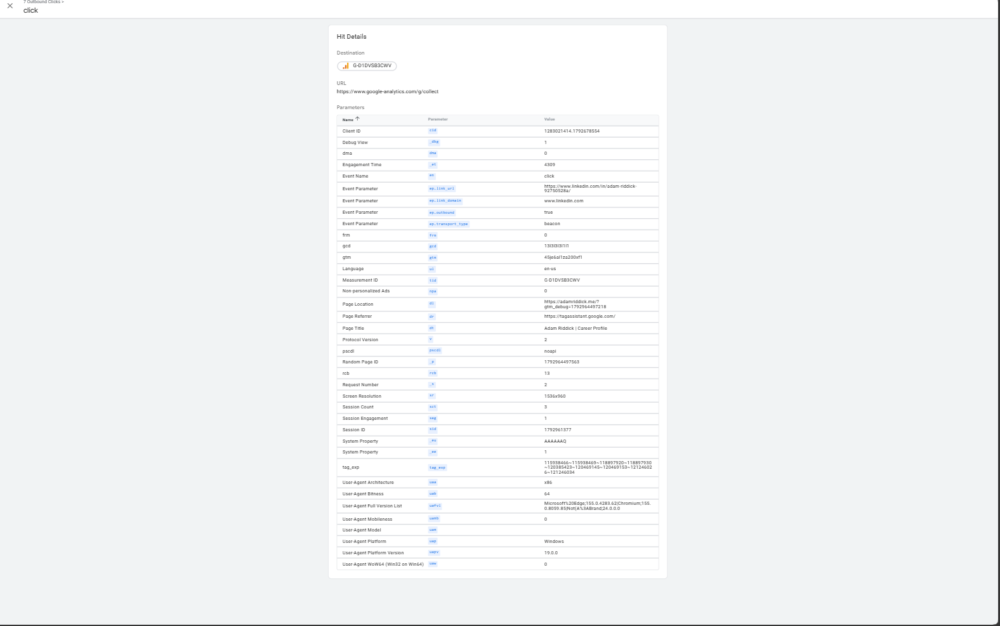
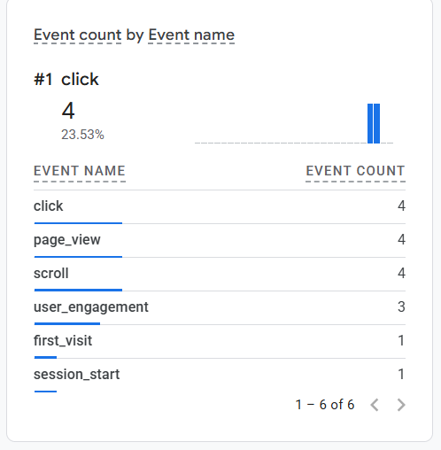
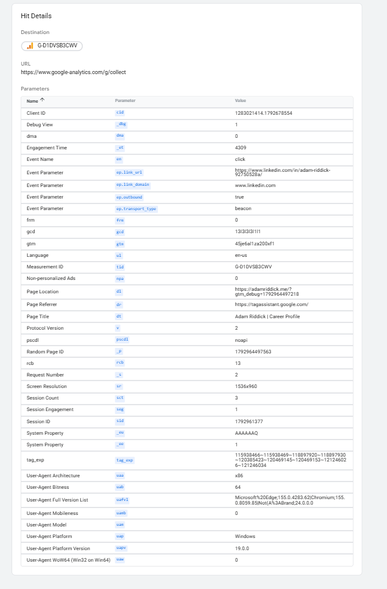

## Google Analytics 4

Live site: https://adamriddick.me
Privacy page: https://adamriddick.me/privacy

### Investigated failure: events never reached my GA4 property

**Symptom.** GA4 Home said "No data received from your website yet," Realtime stayed at zero, and the data stream showed a data collection warning, even though the browser was sending events.

**Check (October 25, 2026).** Tag Assistant showed the site's tag as `G-D1DVSB3CWV`, and the `click` hit was sent to `google-analytics.com/g/collect` with `link_url` = my LinkedIn profile, `link_domain` = `www.linkedin.com`, `outbound` = true. GA4 Home showed my property's Measurement ID as `G-D1DVSBC3WV`.

**Diagnosis.** Two characters were swapped in the site's code (`B3C` instead of `BC3`). The browser delivered every event, but to an ID that is not my property, so GA4 never recorded them.

**Repair.** Commit `0c5c65f` corrected the ID in `static/analytics-consent.js` and its test. Railway deployed it automatically from GitHub.

**Repeated check (October 25, 2026, <time> PM).** On the live site I accepted analytics in Privacy settings, reloaded the page, and clicked the LinkedIn link once. GA4 Realtime showed `page_view` and `click`, and the click's `link_url` was my LinkedIn profile.

### How it works and why it matters

After a visitor accepts analytics, the Google tag in their browser sends each event to Google's collect endpoint, tagged with my Measurement ID, and GA4 records it in the matching property. Before consent, nothing is sent, and the site works normally if tracking is declined.

The outbound click shows that a visitor went from my site to my LinkedIn profile, so the site is driving people to my professional profile. It does not tell me why they clicked or what they did on LinkedIn.