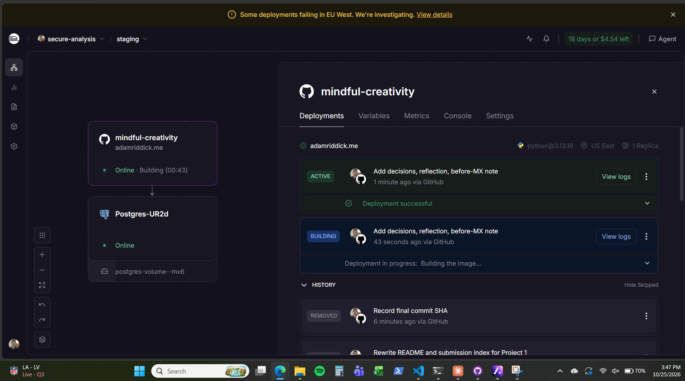
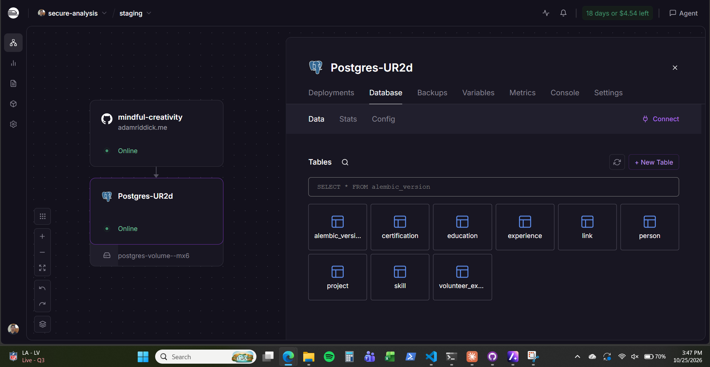
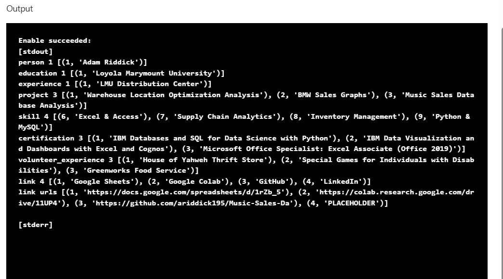
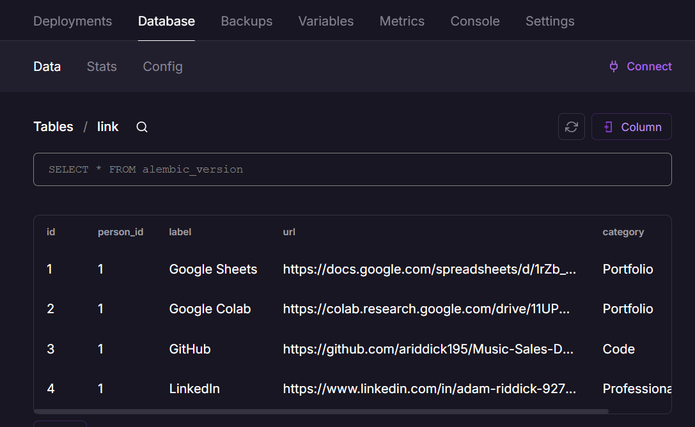
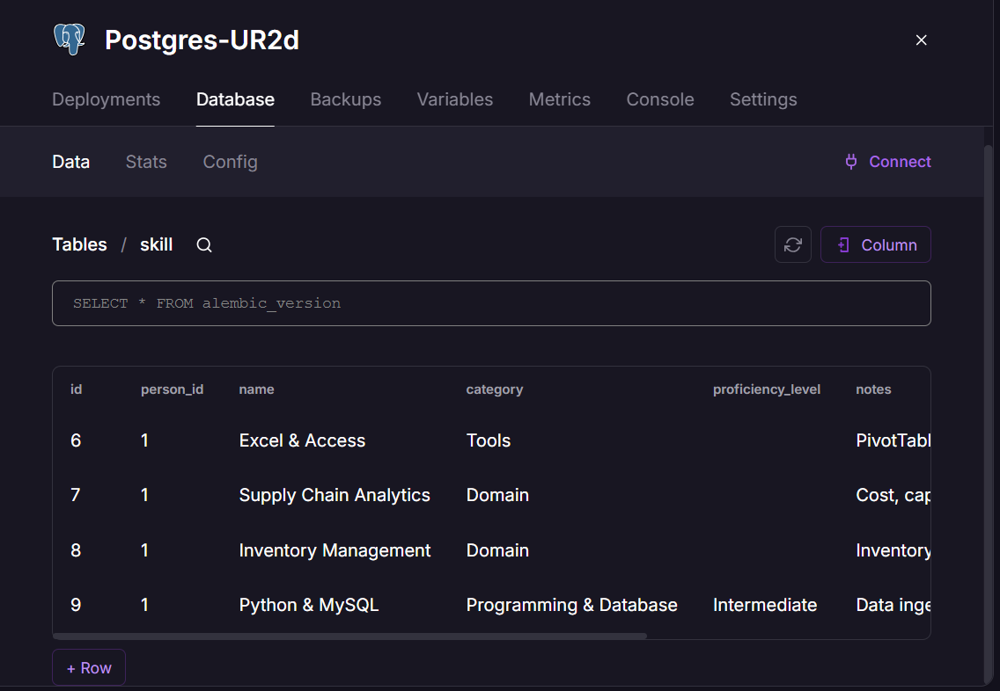
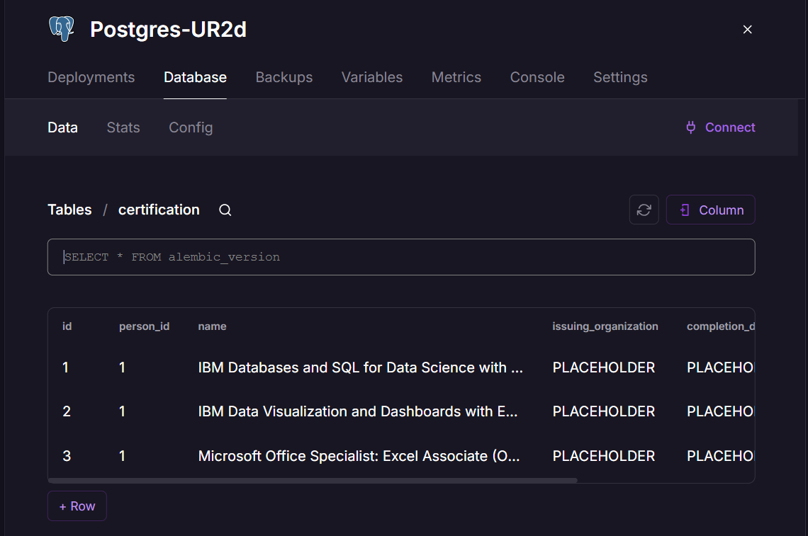
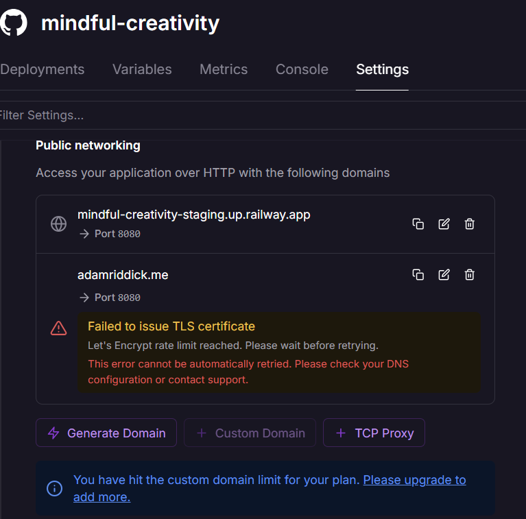
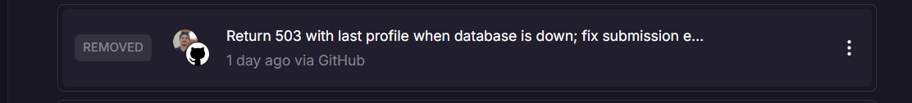
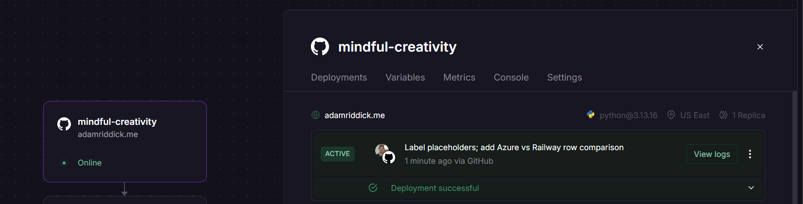
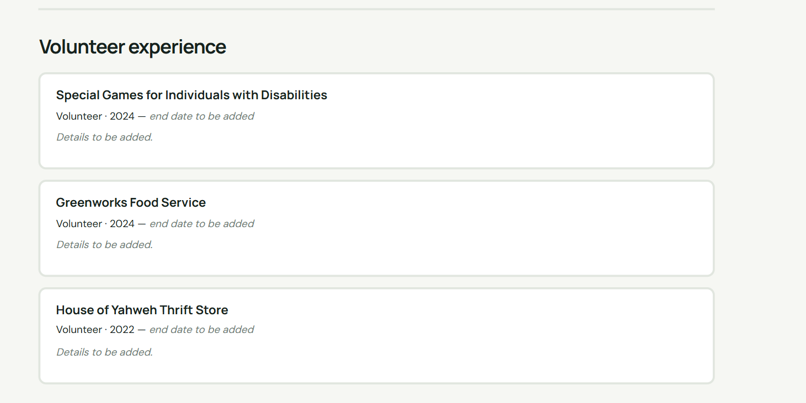

# Railway Migration Evidence

All times are Pacific (PDT) on Friday, October 23, 2026, unless noted. Command output is copied from the PowerShell session on my laptop. Later checks are dated where they were made.

## 1. Railway setup observed

Observed in the Railway dashboard at about 4:45 PM:

- Project `secure-analysis`, environment `staging`.
- Web service `mindful-creativity`, connected to `ariddick195/career-platform` on GitHub, branch `main`. Generated domain `mindful-creativity-staging.up.railway.app`, port 8080, Python 3.13.
- PostgreSQL service `Postgres-UR2d`, status Online, with volume `postgres-volume--mx6`.
- Trial: **20 days or $4.67 left** as of October 23, 2026 (about November 12, 2026); **18 days or $4.54 left** on October 25, 2026, 3:47 PM.
- Postgres Database tab lists the Alembic schema tables: `alembic_version`, `person`, `education`, `experience`, `project`, `skill`, `certification`, `volunteer_experience`, `link`.
- The Railway-generated URL showed my full profile and projects.

Screenshots (October 25, 2026, 3:47 PM). The canvas shows both services Online, the custom domain on the web service, and the latest commit deployed from GitHub:





## 2. Current data comparison

Source counts (Azure SQLite backup, from the [migration runbook](../railway-migration-runbook.md)) against Railway PostgreSQL, counted in the Railway Database tab on October 25, 2026. All eight tables match, and `alembic_version` holds `0001_initial_schema`:

| Table | Azure source | Railway | Match |
|---|---:|---:|---|
| person | 1 | 1 | Yes |
| education | 1 | 1 | Yes |
| experience | 1 | 1 | Yes |
| project | 3 | 3 | Yes |
| skill | 4 | 4 | Yes |
| certification | 3 | 3 | Yes |
| volunteer_experience | 3 | 3 | Yes |
| link | 4 | 4 | Yes |

### Row-by-row comparison (October 25, 2026)

I read the Azure source database read-only through Azure Run command (`sqlite3` with `mode=ro` on `/var/lib/career-platform/career-platform.db`) and compared each row's ID and main field with the Railway tables shown in the screenshots below.

| Table | Azure source rows (ID: value) | Railway | Match |
|---|---|---|---|
| person | 1: Adam Riddick | same | Yes |
| education | 1: Loyola Marymount University | same | Yes |
| experience | 1: LMU Distribution Center | same | Yes |
| project | 1: Warehouse Location Optimization Analysis; 2: BMW Sales Graphs; 3: Music Sales Database Analysis | same | Yes |
| skill | 6: Excel & Access; 7: Supply Chain Analytics; 8: Inventory Management; 9: Python & MySQL | same IDs and names | Yes |
| certification | 1: IBM Databases and SQL for Data Science with Python; 2: IBM Data Visualization and Dashboards with Excel and Cognos; 3: Microsoft Office Specialist: Excel Associate (Office 2019) | same (names cut off in the screenshot) | Yes |
| volunteer_experience | 1: House of Yahweh Thrift Store; 2: Special Games for Individuals with Disabilities; 3: Greenworks Food Service | same | Yes |
| link | 1: Google Sheets; 2: Google Colab; 3: GitHub; 4: LinkedIn | same IDs and labels | Yes, except link 4's URL |

The one difference is expected: link 4's URL is `PLACEHOLDER` on Azure and my real LinkedIn URL on Railway, because of the change described below. Matching IDs (including the skill IDs 6 to 9) show the rows were copied with their original keys, as the transfer tool does.



**Not recorded:** the original transfer run itself (date, command, and the counts and digests the tool prints) was not saved. The comparison above was made afterward, on October 25, 2026, and shows the result of that transfer.

**Real change made after the transfer (October 23, 2026, about 4:50 PM):** In the Railway `link` table, I replaced the LinkedIn URL, which pointed to a placeholder (`https://www.adamriddick.me/PLACEHOLDER`), with my real LinkedIn profile URL. The corrected link appears on the live site. The Azure database still has the placeholder, so the Railway database is a separate, current copy, not restored seed data.

No screenshot exists of the placeholder in Railway before the change; I made the change before capturing it. After the change, row 4 of the `link` table holds the real LinkedIn URL:



**Why this is the transferred Azure data and not the development seed.** The seed in [`seed_data.py`](../../seed_data.py) creates 1 project, 1 link, no volunteer rows, and skills named "Python" and "MySQL" with IDs 1 to 4. Railway instead holds 3 projects, 4 links, 3 volunteer rows, skills with IDs 6 to 9 (including "Inventory Management" and "Python & MySQL"), and `PLACEHOLDER` values in certification and volunteer fields that the seed never writes. The seed could not have produced these rows; they match the live Azure site before cutover, which showed the same placeholders (for example, the volunteer end dates).





## 3. Before cutover

Rollback value recorded first: the Cloudflare root record was **A `adamriddick.me` -> `9.205.27.2`** (Azure VM), DNS only.

```text
> nslookup adamriddick.me 1.1.1.1
Name:    adamriddick.me
Address:  9.205.27.2

> curl.exe -si https://adamriddick.me     (4:44 PM)
HTTP/1.1 200 OK
Server: nginx/1.24.0 (Ubuntu)
```

Result: the site was live over HTTPS, served by Nginx on the Azure VM.

## 4. Cutover

About 5:04 PM:

1. In Railway, added custom domain `adamriddick.me` on port 8080. Railway asked for a CNAME `@ -> kvovk0pv.up.railway.app` and a TXT record `_railway-verify`.
2. I used Railway's one-click Cloudflare setup. It created the CNAME and TXT records and deleted the conflicting A record (`9.205.27.2`). It left the `www` record and all Zoho mail records (MX, SPF, DKIM, DMARC, verification) unchanged.
3. The one-click setup created the CNAME as **Proxied** (orange cloud), not DNS only.

```text
> curl.exe -si https://adamriddick.me     (5:07 PM)
HTTP/1.1 200 OK
Server: cloudflare
x-railway-request-id: Pbl5GGB2Tt-C400HozsQ6Q

> nslookup adamriddick.me 1.1.1.1
Addresses:  104.21.86.2, 172.67.213.78 (+ IPv6)
```

Result: Railway answered (`x-railway-request-id`), through Cloudflare's proxy.

## 5. Investigated failure: TLS certificate after switching to DNS only

**Symptom.** To follow the course rule (records that reach my server are DNS only), I switched the root CNAME to DNS only at about 5:10 PM. DNS then pointed straight to Railway, but HTTPS failed:

```text
> nslookup adamriddick.me 1.1.1.1     (5:13 PM)
Address:  69.46.46.83

> curl.exe -sSi https://adamriddick.me
curl: (60) schannel: SNI or certificate check failed: SEC_E_WRONG_PRINCIPAL (0x80090322) - The target principal name is incorrect.
```

**Checks.**
- 5:19 PM: Railway's domain entry showed "Cloudflare proxy detected".
- 5:20 PM: Railway showed "Failed to issue TLS certificate. Let's Encrypt rate limit reached. Please wait before retrying." It also said this error is not retried automatically.

**Diagnosis.** `SEC_E_WRONG_PRINCIPAL` means the server presented a certificate for a different name (Railway's default `*.up.railway.app` certificate), because no certificate for `adamriddick.me` had been issued. Railway had checked DNS while the record was proxied, so it relied on Cloudflare for HTTPS and did not issue its own certificate. When it tried after the switch, Let's Encrypt refused because of a rate limit on certificate requests for this domain.

**Temporary repair.** At about 5:22 PM, I switched the root CNAME back to Proxied so Cloudflare provides the visitor-facing certificate:

```text
> curl.exe -sSi https://adamriddick.me     (5:23 PM)
HTTP/1.1 200 OK
Server: cloudflare
x-railway-request-id: d_0kbspISbijg7fjCx5-qw
```

**Remaining limitation.** The root record is Proxied, not DNS only as the course requires. Visitors see Cloudflare's certificate, not a Railway-issued one.

**Recurrence (October 25, 2026).** At 4:44 PM the site failed again for all visitors. The root CNAME had been set back to DNS only, and Railway still had no certificate for the domain:

```text
> curl.exe -sSI https://adamriddick.me
curl: (60) schannel: SNI or certificate check failed: SEC_E_WRONG_PRINCIPAL (0x80090322) - The target principal name is incorrect.

> nslookup adamriddick.me 1.1.1.1
Address:  69.46.46.83
```

The single Railway address (instead of Cloudflare's `104.21.x` / `172.67.x`) showed the record was DNS only. Railway still showed the rate-limit error. At about 4:47 PM I set the CNAME back to Proxied and repeated the check:

```text
> nslookup adamriddick.me 1.1.1.1      (4:49 PM)
Addresses:  2606:4700:3037::6815:5602, 2606:4700:3033::ac43:d54e, 172.67.213.78, 104.21.86.2

> curl.exe -si https://adamriddick.me
HTTP/1.1 200 OK
Server: cloudflare
x-railway-request-id: PQglUYIwTreMO0cYg4a9AQ
x-railway-edge: lax1
```

Edge then showed a valid certificate for `adamriddick.me` issued by Let's Encrypt (YE2), expiring January 6, 2027. Lesson: while Railway has no certificate, the record must stay Proxied; switching it to DNS only takes the site down.

**Next check.** After the rate limit window passes: switch the CNAME to DNS only, remove and re-add `adamriddick.me` in Railway (without one-click setup), wait for the certificate, and repeat `curl.exe -sSi https://adamriddick.me` and the `openssl` certificate check. Record the result here when done.

The "Cloudflare proxy detected" status (5:19 PM) was observed but not captured. The rate-limit error was still shown on October 25, 2026, 3:47 PM:



## 6. www redirect

At about 5:25 PM, I set the `www` CNAME (target `adamriddick.me`) to Proxied and created the Cloudflare redirect rule `Redirect www to root`: Request URL `http*://www.*`, Target URL `https://${2}`, 301, preserve query string.

```text
> curl.exe -sSI http://www.adamriddick.me     (5:27 PM)
HTTP/1.1 301 Moved Permanently
Location: https://adamriddick.me/
Server: cloudflare

> curl.exe -sSI https://www.adamriddick.me
HTTP/1.1 301 Moved Permanently
Location: https://adamriddick.me/
Server: cloudflare
```

Result: both `http://www` and `https://www` redirect to the root with a 301.

## 7. Verified website update

- **Commit:** `ae000c0`, "Return 503 with last profile when database is down; fix submission encoding; add Zoho evidence".
- **Review:** I reviewed the diff locally before committing. Unit tests on October 23: 52 run; all passed except one macOS-only temp-path test when run on a Mac. Re-checked on October 25 against the current `main`: 52 Python tests passed (1 skipped) and 6 JavaScript consent tests passed.
- **Deployment:** Railway's Deployments tab showed this commit as **ACTIVE, "Deployment successful", via GitHub** at about 4:45 PM on October 23. On October 25 the history lists it as **REMOVED**, Railway's label for a deployment replaced by a newer one (each later push redeployed, most recently `Add decisions, reflection, before-MX note`, shown ACTIVE in the canvas screenshot above).


- **Live result:** After cutover, `https://adamriddick.me` returns 200 from Railway (section 4). The new behavior (HTTP 503 and "Projects temporarily unavailable" when the database is down) is covered by unit tests; I did not take the production database down to show it live.

**Second verified update (October 25, 2026).** Commit "Label placeholders; add Azure vs Railway row comparison" changed the homepage to show "end date to be added" and "Details to be added." instead of the raw `PLACEHOLDER` value, with a new unit test (53 tests passed). Railway deployed it from GitHub ("Deployment successful"), and the live site showed the new labels after a hard refresh.





## 8. Rollback

**Code.** In Railway, Deployments: open the previous successful deployment's menu and choose Redeploy. Or run `git revert <commit>` and push, which Railway deploys automatically.

**Data.** Since cutover, Railway PostgreSQL has had at least one write that Azure does not have (the LinkedIn fix). Pointing DNS back to Azure would serve stale data. Before any rollback:

1. Stop admin writes on Railway.
2. Back up PostgreSQL (Railway Backups tab).
3. Export Railway data to a **new** SQLite file with `python -m scripts.transfer_database --direction postgres-to-sqlite --sqlite-path <new-file>.db` (with `DATABASE_URL` set to the Railway database for that one command), and verify counts.
4. Install that file on the Azure VM, then restart the service.

**DNS.** In Cloudflare, change the root record back to **A `adamriddick.me` -> `9.205.27.2`**, DNS only, and remove the `_railway-verify` TXT. Azure's Let's Encrypt certificate covers `adamriddick.me` and `www.adamriddick.me`.

**Azure state.** The VM stays running, as the instructor requires, until told otherwise.

## 9. Open items

- [x] Row counts in section 2 (all eight match)
- [x] Railway canvas, tables, deploy history, and TLS error screenshots (October 25)
- [x] `railway-link-after.png`
- [ ] Railway certificate retry (section 5)
- [x] No pending "Apply change" banner in Railway on October 25
- [ ] Remove the Postgres TCP Proxy if it is enabled
